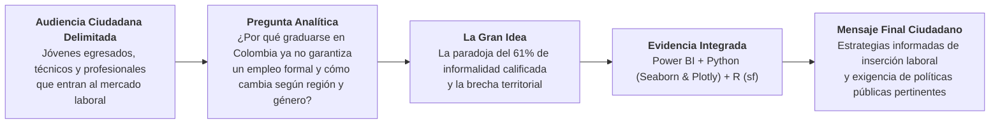

# Plan Estratégico de Implementación — Proyecto 3: Narrativa Visual Integrada
**Asignatura:** Visualización I — Universidad Externado de Colombia  
**Docentes:** Adriana Pineda Barón & Paola Moreno  
**Equipo:** Julián Steven Duarte & Julián Camilo Jiménez  
**Fecha de Entrega:** 17 de noviembre de 2026, 11:59 p.m.  
**Fuente de Datos Principal:** Gran Encuesta Integrada de Hogares (GEIH 2026) — DANE  

---

## 1. Escenario Estratégico y Enfoque Comunicativo

Para esta entrega final, dejamos atrás el rol de asesores del Ministerio (Proyecto 1) y el de investigadores metodológicos (Proyecto 2). Asumimos el rol de **comunicadores de datos** orientados a una **audiencia ciudadana no especializada**.

### 1.1. Delimitación de la Audiencia
* **Público Objetivo:** Jóvenes de 18 a 28 años, técnicos, tecnólogos y profesionales recién egresados o en búsqueda de su primera vinculación laboral en Colombia.
* **Necesidad de Comprensión:** Romper la falsa expectativa de que cursar educación superior resuelve automáticamente la estabilidad laboral y entender qué realidades territoriales y de género determinan la calidad del empleo.
* **Lenguaje:** Claro, empático, sin tecnicismos matemáticos, usando analogías cotidianas y gráficos visualmente transparentes.

### 1.2. La Gran Idea Central
> *"En Colombia, graduarse de la educación técnica o superior ya no es un pasaporte asegurado hacia el empleo digno: más de 6 de cada 10 jóvenes y profesionales subsisten bajo contratos informales o sin seguridad social. Esta paradoja laboral no golpea a todos por igual: se agrava drásticamente en la periferia del país (superando el 75%) y castiga a las mujeres con una barrera oculta de trabajo de cuidado no remunerado. Comprender esta evidencia permite a los jóvenes tomar decisiones laborales estratégicas y exige al país pasar del subsidio a ciegas a la verdadera formalización productiva."*

---

## 2. Arquitectura de Entregables del Proyecto 3

| Componente | Herramienta | Requisitos de la Rúbrica | Estado |
| :--- | :--- | :--- | :--- |
| **Tablero Principal** | **Power BI Desktop & Service** | Dashboard de Proyecto 1 actualizado, métricas DAX pulidas (promedio mensual), diseño adaptado a lenguaje ciudadano y funcional. | 🟡 Guía y DAX listos; pendiente aplicación manual por el usuario. |
| **Análisis Estático** | **Python (Seaborn)** | Mínimo 2 visualizaciones estáticas inéditas o sustancialmente mejoradas, títulos explicativos, sin redundancias. | 🟢 En construcción por Antigravity. |
| **Explorador Dinámico** | **Python (Plotly)** | Mínimo 1 componente interactivo o mini-dashboard para filtrado ciudadano, exportado en HTML funcional. | 🟢 En construcción por Antigravity. |
| **Análisis Espacial** | **R (`sf` + `ggplot2`)** | Al menos 1 mapa temático departamental riguroso, escala cartográfica, rosa de los vientos, leyenda y fuente oficial DANE. | 🟢 En construcción por Antigravity. |
| **Producto Narrativo Integrado** | **Presentación PDF (10 slides)** | Modalidad A: Máximo 10 diapositivas que articulan inicio, desarrollo y cierre uniendo las 3 herramientas. | 🟢 En construcción por Antigravity. |
| **Documentación & Reproducibilidad** | **README, Scripts y Rutas** | Carpeta estructurada, rutas relativas, archivo LEEME de ejecución, anexo técnico de uso ético de IA (máx. 1 pág.). | 🟢 En construcción por Antigravity. |
| **Sustentación Oral** | **Pitch Ciudadano (10 min)** | Libreto estructurado (1 min problema, 2 min Big Idea, 5 min evidencia interactiva, 2 min cierre) + banco técnico de respuestas. | 🟢 En construcción por Antigravity. |

---

## 3. Matriz de Responsabilidades y Flujo de Trabajo

### A. Lo que ejecuta Antigravity (Desarrollo analítico integral):
1. **Extracción y procesamiento de datos:** Consolidación de microdatos de la GEIH 2026 y preparación de tablas maestras para Python y R.
2. **Notebook Jupyter (`Equipo_Duarte_Jimenez_Proyecto3_Python.ipynb`):**
   * Gráfico Seaborn 1: *La Paradoja de la Educación* (Informalidad por nivel educativo y edad).
   * Gráfico Seaborn 2: *La Brecha Oculta de Género* (Informalidad vs. carga horaria no remunerada).
   * Componente Plotly: Explorador interactivo con selector departamental y tarjetas comparativas ciudadanas (`visualizacion_interactiva_plotly.html`).
3. **Script en R y Generación Cartográfica (`mapa_territorial_colombia.R`):**
   * Vinculación de GeoJSON de departamentos de Colombia con tasas oficiales GEIH 2026.
   * Exportación de `mapa_informalidad_colombia.png` en 300 DPI con escala y orientación.
4. **Guía de Actualización Power BI (`GUIA_POWER_BI.md`):**
   * Fórmulas DAX exactas listas para copiar y pegar (incluyendo el cálculo de promedio mensual de ocupados).
   * Lista de verificación paso a paso para ajustar títulos, tarjetas y colores en Power BI Desktop.
5. **Contenido de la Presentación de 10 Diapositivas (`PRESENTACION_NARRATIVA_10_SLIDES.md`):**
   * Storyline completo lámina por lámina, conectando los 3 entornos técnicos.
6. **Anexo Técnico de IA (`Anexo_IA.md`) y `README.md` del repositorio:**
   * Declaración transparente de uso de IA según lineamientos de la Universidad Externado de Colombia.
7. **Guía Maestra de Sustentación Oral (`Guia_Sustentacion_Proyecto3.md`):**
   * Guion cronometrado para Julián Duarte y Julián Jiménez con banco de preguntas frecuentes.

### B. Lo que le corresponde realizar al usuario:
1. **En Power BI Desktop:**
   * Abrir `Proyecto_Visualizacion.pbix`.
   * Crear o modificar las medidas DAX indicadas en `GUIA_POWER_BI.md`.
   * Verificar que las tarjetas KPI muestren los valores promedio mensuales (~17.5M ocupados y ~9.5M informales).
   * Hacer clic en **Publicar** a Power BI Service y copiar el enlace web actualizado.
2. **En la Presentación Final:**
   * Volcar los textos y las imágenes exportadas en la plantilla de diapositivas de su preferencia (PowerPoint / Canva / Google Slides) y exportar el PDF final de 10 láminas.
3. **En la Sustentación Oral:**
   * Ensayar la exposición de 10 minutos en pareja usando el libreto preparado.

---

## 4. Cronograma de Ejecución Inmediata

| Fase | Tarea | Responsable | Estado |
| :---: | :--- | :---: | :---: |
| **Fase 1** | Registro del Plan de Implementación y estructura de carpetas en `proyecto 3` | Antigravity | ✅ Completado |
| **Fase 2** | Redacción de `GUIA_POWER_BI.md` con DAX y pasos de actualización | Antigravity | 🚀 En curso |
| **Fase 3** | Desarrollo y ejecución del Notebook de Python (Seaborn + Plotly + HTML) | Antigravity | ⏳ Pendiente |
| **Fase 4** | Desarrollo y ejecución del script de R (Mapa temático departamental en PNG) | Antigravity | ⏳ Pendiente |
| **Fase 5** | Redacción del Storyline de 10 diapositivas, `README.md` y `Anexo_IA.md` | Antigravity | ⏳ Pendiente |
| **Fase 6** | Guía de Sustentación Oral (Pitch de 10 min y banco de preguntas) | Antigravity | ⏳ Pendiente |
| **Fase 7** | Actualización de Power BI Desktop y publicación en Service | Usuario | ⏳ Acción de usuario |
