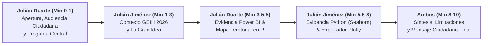

# Guía Maestra de Sustentación Oral — Proyecto 3: Narrativa Visual Integrada
**Asignatura:** Visualización I — Universidad Externado de Colombia  
**Docentes:** Adriana Pineda Barón & Paola Moreno  
**Equipo:** Julián Steven Duarte & Julián Camilo Jiménez  
**Tiempo Total:** 10 Minutos estrictos de presentación + Ronda de preguntas técnicas  
**Rol del Equipo:** Comunicadores de datos ante una audiencia ciudadana no especializada  

---

## 1. Puesta en Escena y Dinámica de Exposición

> [!IMPORTANT]
> **Tono y Reglas de Oro para la Sustentación:**
> * **Cero tecnicismos innecesarios:** No aburrir a la audiencia explicando líneas de código, librerías o fórmulas matemáticas como si fuera una clase de programación.
> * **Enfoque humano y empático:** Hablamos a jóvenes que buscan trabajo en Colombia, a familias y a ciudadanos que quieren entender por qué el empleo formal es tan esquivo.
> * **Interacción con los productos:** Durante los 5 minutos de evidencia, interactuar con el tablero de Power BI, señalar los contrastes del mapa en R y pasar el cursor sobre el gráfico interactivo de Plotly.

---

## 2. Libreto Cronometrado de 10 Minutos (Minuto a Minuto)

### Bloque 1: Apertura, Audiencia Ciudadana y Pregunta Central (0:00 – 1:00)
* **Voz:** Julián Duarte  
* **Pantalla:** Diapositiva 1 y 2.  
* **Tono:** Cálido, reflexivo y de conexión directa con la sala.

> *"Buenos días, profesoras y compañeros:*  
> 
> *A lo largo de nuestras vidas, en nuestros hogares y colegios se nos repitió una promesa casi sagrada: 'Estudie, saque un título técnico o profesional, y tendrá la vida asegurada con un empleo digno y formal'.*  
> 
> *Hoy asumimos el rol de comunicadores de datos para hablarle directamente a una audiencia muy concreta: **a los jóvenes de 18 a 28 años, a los recién egresados universitarios y a quienes hoy tocan puertas buscando su primer empleo formal en Colombia**.*  
> 
> *Venimos a responder una pregunta que miles de familias se hacen hoy:*  
> **¿Por qué en Colombia tener un título universitario ya no garantiza conseguir un trabajo con seguridad social, y de qué manera la región donde vivimos y nuestro género definen nuestras oportunidades reales de empleo?**  
> 
> *Paso con mi compañero Julián Jiménez para presentar el diagnóstico y La Gran Idea de nuestra historia."*

---

### Bloque 2: Contexto, Fuente y La Gran Idea (1:00 – 3:00)
* **Voz:** Julián Jiménez  
* **Pantalla:** Diapositiva 3.  
* **Tono:** Contundente, asertivo y basado en evidencia sólida.

> *(Toma la palabra Julián Jiménez)*  
> 
> *"Gracias, Julián. Para responder esta pregunta no acudimos a opiniones, sino a la evidencia estadística oficial más robusta del país: la **Gran Encuesta Integrada de Hogares (GEIH 2026) del DANE**, expandida a través del Censo Nacional.*  
> 
> *Al analizar estos datos descubrimos una verdad incómoda que resumimos en **La Gran Idea** que hoy compartimos con la ciudadanía:*  
> 
> **'En Colombia, más de 6 de cada 10 graduados con educación superior están atrapados en la informalidad o el rebusque calificado (61.3%). Esta trampa se agrava drásticamente en la periferia del país (llegando al 75.7% en departamentos como Guaviare) y oculta una grave brecha de género por el trabajo de cuidado no remunerado.'**  
> 
> *Esta Gran Idea se sostiene sobre tres realidades:*  
> *Primero: estudiar más en Colombia ya no rompe la informalidad.*  
> *Segundo: existe una verdadera 'lotería territorial' donde nacer fuera del centro del país triplica el riesgo de desprotección.*  
> *Y tercero: las mujeres enfrentan una exclusión silenciosa previa antes de poder si quiera postularse a un trabajo.*  
> 
> *A continuación, Julián Duarte abrirá nuestros tableros para mostrar la evidencia en vivo."*

---

### Bloque 3A: Evidencia en Power BI y Mapa Territorial en R (3:00 – 5:30)
* **Voz:** Julián Duarte  
* **Pantalla:** Diapositiva 4 (Power BI Service en vivo) y Diapositiva 8 (Mapa en R).  
* **Acción en vivo:** Mostrar el tablero actualizado en Power BI, mover el slicer y luego abrir la vista del mapa en R.

> *(Retoma la palabra Julián Duarte)*  
> 
> *"Para traducir esta problemática a la ciudadanía, actualizamos integralmente nuestro **Dashboard en Power BI**:*  
> 
> 1. **La Foto Mensual Real:** *Corregimos la lectura semestral acumulada. Ahora el ciudadano observa con total claridad que en Colombia trabajan mes a mes **~17.5 millones de personas**, de las cuales **~9.55 millones están en la informalidad**, lo que ratifica una tasa nacional del **54.64%**.*  
> 
> 2. **La Disparidad Territorial en R:** *(Señalando el mapa en R)*  
> *Para entender el territorio construimos este mapa temático en R con la capa cartográfica oficial del IGAC. Miren el contraste:*  
> * *Las zonas en azul representan los departamentos centrales, pero conforme nos desplazamos hacia la Amazonía y Orinoquía, el mapa se enciende en colores vino tinto de alerta crítica:*  
> * ***Guaviare lidera el país con un alarmante 75.7% de informalidad**, seguido de **Casanare con un 66.5%**.*  
> * *¿Qué significa esto para un joven que vive en San José del Guaviare o en Yopal? Que 3 de cada 4 oportunidades de empleo en su entorno carecen de pensión, salud o cesantías. Su única salida suele ser migrar o buscar oportunidades remotas.*  
> 
> *Paso con Julián Jiménez para ver qué pasa con la educación y el género en Python."*

---

### Bloque 3B: Evidencia en Python: Seaborn y Explorador Plotly (5:30 – 8:00)
* **Voz:** Julián Jiménez  
* **Pantalla:** Diapositivas 5, 6 y 7 (o notebook / HTML interactivo en vivo).  
* **Acción en vivo:** Pasar el cursor sobre el gráfico Plotly en el navegador, mostrando tooltips dinámicos.

> *(Retoma la palabra Julián Jiménez)*  
> 
> *"Al profundizar en Python con Seaborn y Plotly, los datos confirman la paradoja educativa:*  
> 
> 1. **La Paradoja de la Educación Superior (Seaborn):**  
>    *Al comparar los niveles formativos, descubrimos que los trabajadores con **Educación Superior tienen una informalidad del 61.26%**, casi idéntica a quienes tienen secundaria (61.14%) y significativamente superior a quienes solo cursaron primaria (52.37%).*  
>    *¿Cómo se explica esto? El tejido productivo colombiano no está creando puestos de trabajo asalariados formales al mismo ritmo que las universidades gradúan profesionales. El resultado es la precarización profesional: contratos por prestación de servicios de tres meses, cobro por honorarios sin cotización o subempleo.*  
> 
> 2. **La Brecha de Género:**  
>    *En educación superior, los hombres ocupados registran un 65.3% de informalidad frente a un 58.2% en mujeres. Pero no caigamos en la trampa de creer que a las mujeres les va mejor. Lo que ocurre es que millones de mujeres colombianas sufren una barrera de entrada previa: están atrapadas en labores de cuidado del hogar no remuneradas, mientras los hombres son forzados a aceptar cualquier rebusque informal para llevar dinero a casa.*  
> 
> 3. **El Explorador Ciudadano (Plotly):**  
>    *(Moviendo el cursor en el HTML interactivo)*  
>    *Desarrollamos este mini-dashboard para que cualquier persona en Colombia pueda buscar su departamento y comparar su tasa frente al promedio nacional del 54.6%, identificando con un semáforo de riesgo si su territorio está en Alerta Crítica (rojo), Vulnerabilidad Media (amarillo) o Mayor Formalidad (azul)."*

---

### Bloque 4: Síntesis, Limitaciones y Mensaje Ciudadano Final (8:00 – 10:00)
* **Voz:** Compartida (Julián Duarte inicia, Julián Jiménez cierra).  
* **Pantalla:** Diapositivas 9 y 10.  
* **Tono:** Inspirador, propositivo y de impacto social.

> *(Julián Duarte)*  
> *"Frente a esta evidencia, ¿qué le decimos a un joven que hoy se gradúa?*  
> 
> 1. **Educación Financiera y Laboral:** *Si te contratan por prestación de servicios, debes calcular desde el primer día que el 40% de tus honorarios es la base para cotizar a salud y pensión. No renuncies a tu seguridad social por falta de información.*  
> 2. **Movilidad Digital:** *Si estás en regiones como Guaviare o Casanare donde la informalidad supera el 65%, tu mejor alternativa es el teletrabajo hacia empresas formales de las grandes capitales.*  
> 
> *(Julián Jiménez)*  
> 3. **Exigencia Ciudadana:** *Como ciudadanía debemos exigir que los programas de empleo del gobierno dejen de regalar subsidios a ciegas y comiencen a cofinanciar la contratación formal de jóvenes egresados.*  
> 
> *Reconocemos como limitaciones que los microdatos corresponden al primer semestre de 2026 y que los análisis descriptivos no implican causalidad, pero la tendencia es irrefutable.*  
> 
> *Graduarse en Colombia sigue siendo un gran mérito personal, pero los datos nos enseñan que el título por sí solo no basta: se requiere estrategia, información y un cambio profundo en las políticas de empleo del país.*  
> 
> *Muchas gracias. Quedamos atentos a sus preguntas."*

---

## 3. Banco Técnico de Respuestas (Para la Ronda de Preguntas)

### Pregunta 1: ¿Por qué en Power BI la suma de personas daba 105M y cómo lo resolvieron?
* **Respuesta en examen:**  
  *"El factor de expansión del DANE (`FEX_C18`) expande a nivel de muestra mensual (~17.5M ocupados/mes). Al tener cargados los 6 meses del semestre, una suma simple sumaba las personas 6 veces (105M personas-mes acumuladas). Para una audiencia ciudadana creamos la medida DAX con `AVERAGEX(VALUES(DimFecha[Mes]), [Total Ocupados])`, reportando con exactitud los **~17.5 millones de ocupados mensuales** y **~9.55 millones de informales**, manteniendo intacta y verificada la tasa nacional del **54.64%**."*

### Pregunta 2: ¿Cómo construyeron el mapa en R y qué consideraciones espaciales tuvieron?
* **Respuesta en examen:**  
  *"Utilizamos el paquete `sf` y `ggplot2`. Partimos del marco geoestadístico municipal oficial del DANE/IGAC y aplicamos una disolución departamental mediante `group_by(DPTO_CN)` y `st_union(geometry)`. Para optimizar la portabilidad exportamos un GeoJSON ligero (`colombia_departamentos.geojson`). Unimos los datos mediante `left_join` respetando los 33 dominios de representación de la GEIH y empleamos una escala continua perceptualmente ordenada con etiquetas directas en los centroides de los departamentos en alerta roja (Guaviare y Casanare)."*

### Pregunta 3: ¿Por qué dicen que la menor informalidad en mujeres no significa mejor empleo?
* **Respuesta en examen:**  
  *"Porque la tasa de informalidad solo mide a la población **ocupada**. En Colombia existe una profunda asimetría en la tasa de participación laboral: millones de mujeres ni siquiera forman parte de la fuerza de trabajo ocupada porque asumen la totalidad de las cargas de cuidado doméstico no remunerado. Las pocas que logran vincularse suelen hacerlo en sectores como educación, salud y administración pública que tienen mayor formalidad institucional, mientras que los hombres están masivamente presionados a buscar sustento diario en actividades informales."*

### Pregunta 4: ¿Qué principios Gestalt aplicaron en las visualizaciones de Python y R?
* **Respuesta en examen:**  
  *"Aplicamos principalmente **Similitud y Figura-Fondo**: las categorías no prioritarias comparten tonos neutros de gris pizarra (`#94A3B8`), mientras el foco de alerta (Educación Superior y regiones críticas) se destaca con un color semántico saturado (`#E11D48`). Además, aplicamos **Proximidad** mediante etiquetas de datos directas en las barras y en los centroides del mapa, eliminando el esfuerzo visual de alternar la mirada entre la figura y la leyenda."*
